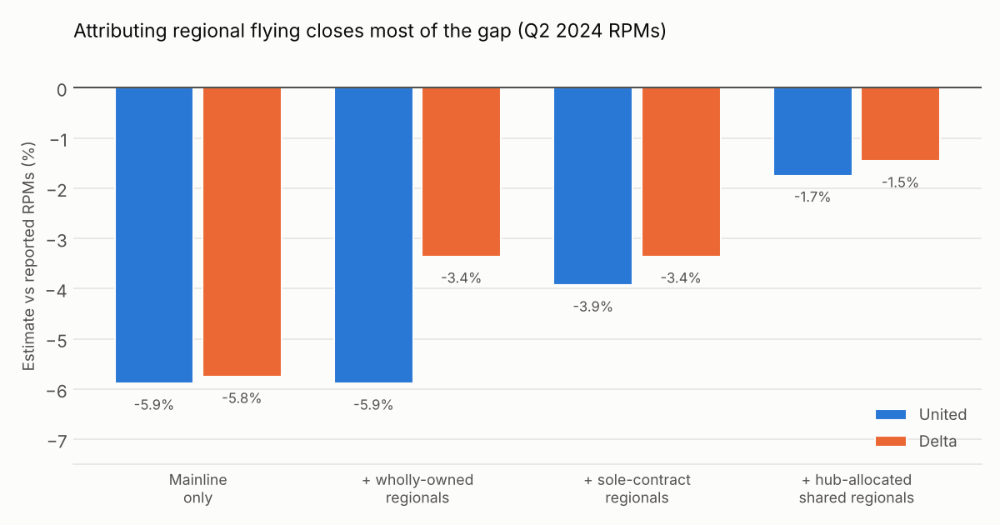
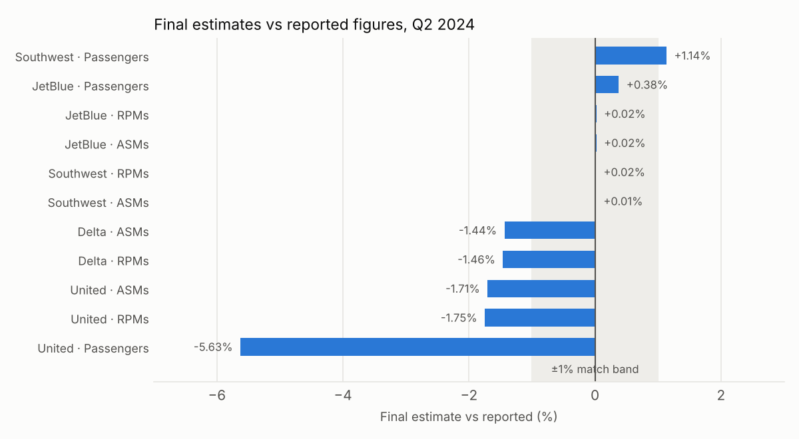
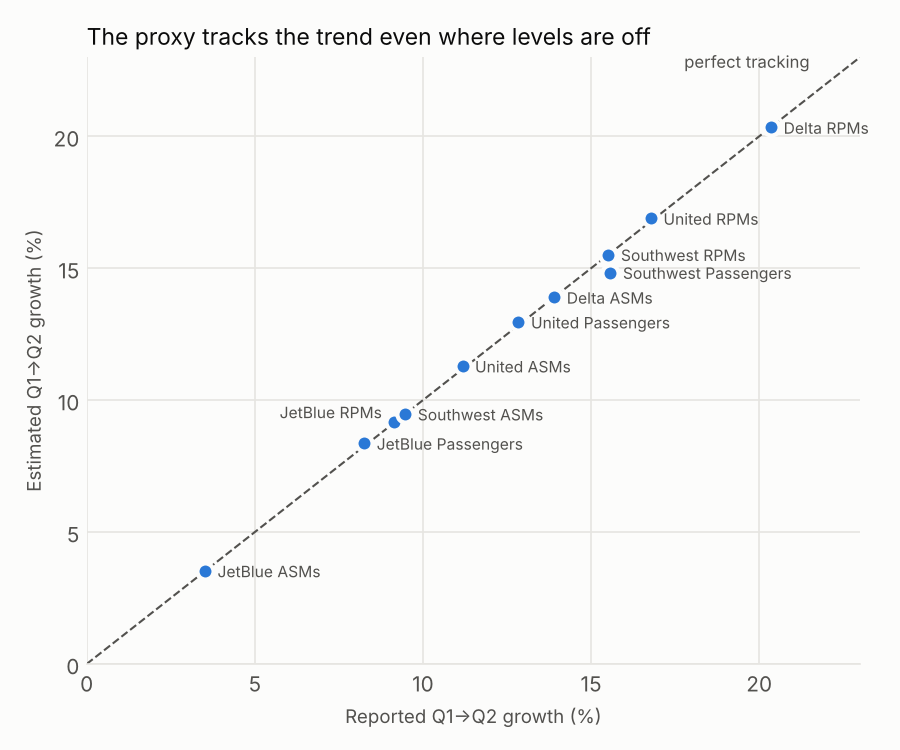

# Airline Passenger KPI Tracker

Can public flight data estimate an airline's quarterly traffic before or alongside its earnings report? This project builds passenger, RPM and ASM estimates for **Southwest, JetBlue, United and Delta** from BTS T-100 segment data with **PySpark and Spark SQL**, benchmarks them against the figures each airline reported for Q1 and Q2 2024, and works out whether each gap is a real business change or a data issue.

**Stack:** PySpark · Spark SQL · Python (pandas, matplotlib) · pytest

## Key results

| | |
|---|---|
| Data | 314k T-100 segment rows (Jan–Jul 2024); Q1–Q2 scheduled and charter passenger service in scope |
| Comparisons | **22** airline × quarter × metric checks against reported figures (SEC filings and earnings releases) |
| Accuracy | Mean absolute error **1.3%** across all 22 (RPMs and ASMs alone: **0.8%**), down from 4.0% using mainline flights only |
| Trend tracking | Estimated Q1→Q2 growth within **0.12 pp** of reported growth for 10 of 11 series (worst: 0.74 pp) |
| Gap classification | 10 matches within ±1%, 10 explained coverage gaps, 2 explained definition gaps, 0 left unexplained |
| Data-quality checks | 7 checks, 0 blocking failures; 44 rows with passengers above seats and 5 airport pairs with inconsistent distances flagged |

## How it works

1. **Scope** (`sql/01_scope.sql`): Q1–Q2 2024 rows for passenger service; compute RPMs (passengers × miles) and ASMs (seats × miles) per row.
2. **Data-quality checks** (`sql/02_quality_checks.sql`): null keys, negative values, quarter/month mismatch and duplicates block the run; passengers above seats, passengers without departures and inconsistent distances are flagged.
3. **Attribute flying to airlines** (`sql/03_attribute_to_airline.sql`): United and Delta report traffic that includes their regional partners, but T-100 lists those flights under the regional carrier (SkyWest, Republic, Endeavor…). Flights are added in stages:
   - the airline's own (mainline) flights
   - wholly-owned regionals (Endeavor → Delta)
   - regionals flying for only one airline (Mesa, CommuteAir, GoJet → United)
   - regionals flying for several airlines (SkyWest, Republic), assigned only when exactly one partner's hub is an endpoint
4. **Quarterly estimates** (`sql/04_quarterly_estimates.sql`) per stage, then compare to reported figures, classify every gap and check Q1→Q2 growth (`src/pipeline.py`).

## Findings

### Regional flying explains the United and Delta gaps

Using mainline flights only, United and Delta come out about 6% below their reported RPMs. Each attribution stage closes part of the gap; the remaining 1.5–1.8% is SkyWest and Republic flying at hubs shared by several airlines (ORD, LGA, LAX, SFO, SEA), which T-100 cannot assign to one airline. About half of those two carriers' RPMs stay unallocated rather than being guessed.



### What each remaining gap is



| Airline | Gap (Q2) | Classification | Why |
|---|---|---|---|
| Southwest, JetBlue: RPMs, ASMs | ≤ 0.02% | Match | No regional partners, so T-100 covers all their flying |
| JetBlue: passengers | +0.4% | Match | |
| Southwest: passengers | +1.1% (Q1 +1.8%) | Data issue: definition | Miles match almost exactly, but T-100 counts passengers per flight segment. Southwest counts each boarding, so a passenger staying on board through a stop is most likely counted twice in T-100 |
| Delta, United: RPMs, ASMs | −1.4% to −1.8% | Data issue: coverage | Unattributable shared regional flying (see above) |
| United: passengers | −5.6% | Data issue: coverage | Same cause, larger effect: regional flights are short, so they carry many passengers but few miles |

A gap that is stable across quarters points to a fixed bias in the data, not a change in the business. All coverage gaps moved by 0.1 pp or less between Q1 and Q2.

### The proxy captures the trend

Even where the level is off, the estimate moves with the reported figure: Q1→Q2 growth is within 0.12 pp for every series except Southwest passengers (0.74 pp, the definition gap above). For tracking a company between earnings reports, growth matters more than level, so a stable coverage bias still leaves a usable signal.



## Limitations

- Only two full quarters (the public mirror ends in July 2024), so 22 comparisons; more quarters would test whether the biases stay stable.
- Hub lists are a simplification; shared regional flying is left unallocated rather than split by an assumed share.
- The Southwest passenger explanation is the most likely one, not confirmed against Southwest's own definitions.

## Run it

Requires Java 17+.

```bash
pip install -r requirements.txt
# put the raw file at data/raw/T_T100_SEGMENT_ALL_CARRIER.csv (see data/README.md)
python src/pipeline.py      # quality checks, estimates, comparison -> outputs/*.csv
python src/charts.py        # charts -> outputs/charts/
pytest -q                   # 7 tests
```

## Outputs

| File | Contents |
|---|---|
| `outputs/data_quality_results.csv` | Each check, rows flagged, action |
| `outputs/regional_attribution_coverage.csv` | Regional RPMs and passengers by assigned airline, including unallocated |
| `outputs/estimate_vs_reported_by_stage.csv` | Every estimate vs reported figure at each attribution stage |
| `outputs/final_estimate_vs_reported.csv` | Final estimates with gap, gap change Q1→Q2 and classification |
| `outputs/growth_check.csv` | Estimated vs reported Q1→Q2 growth |
